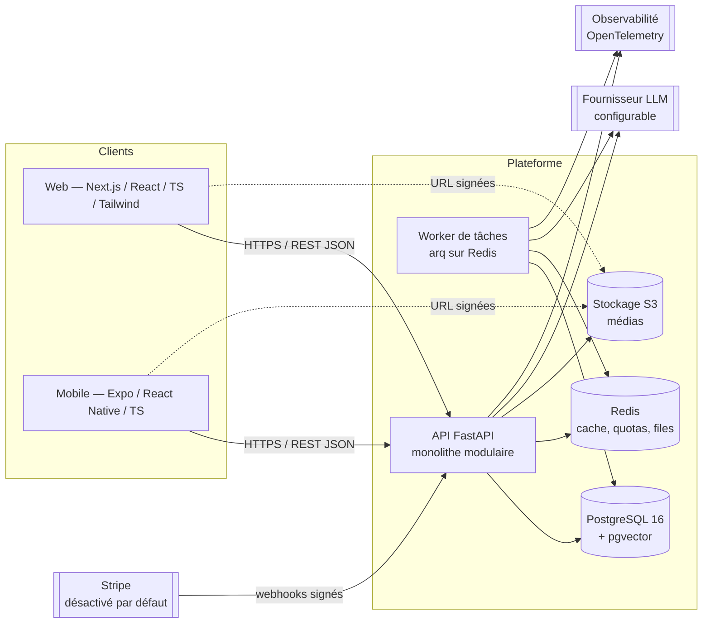
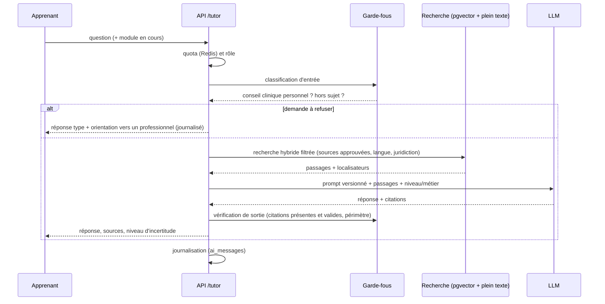

# 03 — Architecture technique

> Phase 1 · version 0.1

## 1. Vue d'ensemble



**Choix clé : un monolithe modulaire** (ADR-0001). Une seule API déployable, découpée en domaines aux frontières strictes (pas d'accès direct aux tables d'un autre domaine). C'est plus simple à tester, déployer et faire évoluer pour une petite équipe ; un domaine peut être extrait plus tard (le tuteur IA est le candidat naturel) sans réécriture.

## 2. Organisation du dépôt (monorepo)

```
nurselearn-ai/
├─ apps/
│  ├─ web/                 Next.js (App Router) — Phase 2
│  └─ mobile/              Expo — Phase 5
├─ services/
│  └─ api/                 FastAPI + SQLAlchemy 2 + Alembic
│     ├─ app/
│     │  ├─ core/          config, sécurité, journalisation, erreurs, i18n
│     │  ├─ db/            session, base, modèles partagés
│     │  └─ domains/
│     │     ├─ identity/       comptes, sessions, rôles, profils
│     │     ├─ reference/      juridictions, métiers, spécialités, périmètres
│     │     ├─ catalog/        programmes, modules, leçons (lecture)
│     │     ├─ authoring/      brouillons, relecture, publication, références
│     │     ├─ learning/       progression, compétences, révisions espacées, plans
│     │     ├─ assessment/     questions, quiz, examens, tentatives, correction
│     │     ├─ simulation/     moteur de scénarios, tentatives
│     │     ├─ tutor/          RAG, prompts, garde-fous, quotas
│     │     ├─ organizations/  établissements, cohortes, rapports
│     │     ├─ billing/        plans, abonnements, paiements
│     │     └─ audit/          journal d'audit, signalements
│     ├─ alembic/          migrations
│     └─ tests/
├─ packages/
│  ├─ design-tokens/       couleurs, typographie, espacements (web + mobile)
│  ├─ api-client/          client TypeScript généré depuis l'OpenAPI — Phase 2
│  ├─ i18n/                chaînes d'interface FR/EN partagées — Phase 2
│  └─ sim-engine/          moteur de simulation en TS pur (partagé web/mobile) — Phase 4
├─ database/               schéma SQL versionné, données de référence, tests de contraintes
├─ infra/                  docker-compose, (Phase 7) déploiement
├─ docs/                   cette documentation, ADR
└─ .github/workflows/      CI
```

Outils : **pnpm + Turborepo** pour le JavaScript, **uv** pour Python, **Ruff + mypy** (Python), **ESLint + Prettier** (TS).

## 3. Backend (FastAPI)

- **Couches par domaine** : `router` (HTTP, validation Pydantic) → `service` (règles métier, transactions) → `repository` (SQLAlchemy). Les routeurs ne touchent jamais la base.
- **Asynchrone** : SQLAlchemy 2 async + asyncpg ; Alembic en synchrone (psycopg).
- **API REST versionnée** `/api/v1`, OpenAPI généré automatiquement, erreurs au format RFC 9457 (`application/problem+json`).
- **Pagination** par curseur ; filtres explicites ; jamais de requête non bornée.
- **i18n** : en-tête `Accept-Language` + préférence de l'utilisateur ; les champs `*_i18n` sont résolus côté API (repli FR → EN ou EN → FR).
- **Résolution de juridiction** : chaque requête d'apprentissage porte la juridiction du profil ; la version de leçon choisie suit l'ordre *juridiction exacte → juridiction parente → contenu commun*.
- **Tâches de fond (arq)** : envoi d'e-mails, ingestion de documents pour le RAG, calcul des statistiques d'items, purge selon la politique de conservation, rappels de révision.

## 4. Base de données

PostgreSQL 16 ; schéma décrit dans [04-modele-donnees.md](04-modele-donnees.md). Les invariants critiques (relecture, attestations, données fictives, audit) sont **garantis par des contraintes SQL**, donc valables quel que soit le client (API, script, console d'administration). Redis sert au cache du catalogue, aux quotas IA, à la limitation de débit et à la file de tâches — jamais comme source de vérité.

## 5. Tuteur IA (Phase 3)



- **Fournisseur configurable** via une interface `LLMProvider` (`complete`, `embed`) ; `LLM_PROVIDER=disabled` par défaut.
- **Sources** : seules les `ai_knowledge_sources` au statut `approved` sont interrogées ; chaque passage garde une référence vers sa source pour la citation.
- **Prompts versionnés** en base (`ai_prompt_templates`), un seul actif par clé et par langue ; chaque message conserve la version utilisée.
- **Évaluation continue** : jeu de questions de référence (réponses attendues + sources) rejoué à chaque changement de prompt ou de modèle ; seuil de non-régression en CI.
- **Quiz générés par l'IA** : stockés `origin = 'ai_generated'`, statut `draft` ; ils ne servent qu'à l'entraînement personnel tant qu'un relecteur ne les a pas approuvés.

## 6. Moteur de simulation (Phase 4)

Un scénario est un **graphe d'états JSON** (`clinical_simulations.scenario`) : nœuds (situation, constantes affichées, médias), choix (libellé, points, conséquence, nœud suivant, `critical: true|false`), nœuds terminaux avec débriefing. Le moteur est une bibliothèque **TypeScript pure** (`packages/sim-engine`), déterministe et testée, exécutée côté client pour la fluidité ; le serveur **rejoue** le chemin soumis pour calculer le score officiel (pas de confiance au client). Le rendu passe par une interface `Renderer` : implémentation 2D en v1, 3D (ex. Three.js / React Three Fiber) plus tard, sans changement du format de scénario.

## 7. Clients

- **Web** : Next.js App Router, rendu serveur pour le catalogue (référencement), composants client pour le lecteur et les quiz ; Tailwind avec le preset `@nurselearn/design-tokens` ; `next-intl` pour l'interface.
- **Mobile** : Expo (React Native), Expo Router, stockage sécurisé des jetons (SecureStore), SQLite pour le hors-ligne, notifications Expo.
- **Partage** : client API généré, chaînes i18n, jetons de design, moteur de simulation.

## 8. Sécurité

| Sujet | Mesure |
|---|---|
| Authentification | Argon2id ; jeton d'accès court (JWT signé, 15 min) ; jeton de rafraîchissement opaque, rotatif, stocké haché, détection de réutilisation → révocation de la famille |
| Stockage des jetons | Web : cookie `HttpOnly; Secure; SameSite=Lax` ; Mobile : SecureStore |
| Autorisation | RBAC par permissions (`role_permissions`), vérifié dans une dépendance FastAPI ; portée par établissement |
| Entrées | Validation Pydantic stricte ; tailles maximales ; nettoyage HTML du contenu riche (liste blanche) |
| Abus | Limitation de débit par IP et par compte (Redis) ; quotas IA ; verrouillage progressif après échecs de connexion |
| Données sensibles | TLS partout ; chiffrement au repos du volume ; champs sensibles (ex. notes de formateur) chiffrés applicativement (`FIELD_ENCRYPTION_KEY`) |
| Secrets | Variables d'environnement, jamais dans le dépôt ; gestionnaire de secrets en production |
| Audit | `audit_logs` en ajout seul et chaîné par hachage ; actions sensibles : connexion, rôles, publication, notes, paiements, export/effacement |
| Conservation | Conversations IA : 365 jours par défaut (`retention_until`), purge par tâche planifiée ; durées paramétrables par juridiction |
| Fichiers | Téléversement direct vers S3 par URL signée ; vérification du type MIME ; analyse antivirus en Phase 7 |
| En-têtes | CSP stricte, HSTS, `X-Content-Type-Options`, `Referrer-Policy` |

## 9. Observabilité et exploitation

OpenTelemetry (traces, métriques) ; journaux JSON structurés avec identifiant de requête et **sans données personnelles** ; tableaux de bord : latence, erreurs, coût et latence IA, files de tâches. Sauvegardes PostgreSQL quotidiennes + journalisation WAL (restauration à un instant donné), test de restauration mensuel. Environnements : `development` (docker-compose), `staging`, `production`.

## 10. Évolutivité

- Ajouter une **langue** : une ligne dans `locales`, des fichiers de traduction d'interface, des versions de leçons ; aucun changement de code.
- Ajouter une **juridiction** : lignes dans `jurisdictions`, `professions`, `competency_scopes` ; les contenus communs sont réutilisés.
- Ajouter une **spécialité** : ligne dans `specialties` puis contenu.
- Passer en **3D** : nouvelle implémentation de `Renderer` ; le format de scénario est inchangé.
- Monter en charge : API sans état (réplicas horizontaux), cache Redis du catalogue publié, CDN devant S3, répliques en lecture PostgreSQL si nécessaire.
