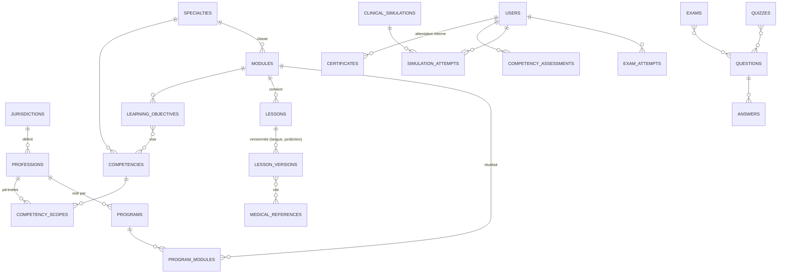

# 04 — Modèle de données

> Phase 1 · source de vérité : [`database/schema/0001_core.sql`](../database/schema/0001_core.sql) (60 tables) · testé sur PostgreSQL 16.

## 1. Conventions

- Clés primaires UUID (`gen_random_uuid()`), sauf tables de référence (`locales`, `countries`, `roles`, `permissions`) et tables en ajout seul (`audit_logs`, `xp_events` : identité `bigint`).
- `created_at` / `updated_at` en `timestamptz` ; `updated_at` maintenu par déclencheur sur **toutes** les tables qui le portent (vérifié par test).
- Textes traduisibles en `jsonb` `{"fr": "…", "en": "…"}`, contrôlés par `nl_has_base_locale()`. Exception : le corps des leçons, versionné **par langue** dans `lesson_versions` (relecture distincte de chaque traduction).
- Énumérations en `text` + `CHECK` : on ajoute une valeur par migration sans verrou lourd.
- **Toute clé étrangère déclare explicitement sa stratégie de suppression** (vérifié par test).

## 2. Domaines et tables

| Domaine | Tables |
|---|---|
| Référentiels | `locales`, `countries`, `jurisdictions` |
| Identité & accès | `users`, `profiles`, `roles`, `permissions`, `role_permissions`, `user_roles`, `auth_sessions` |
| Établissements | `organizations`, `instructors`, `cohorts`, `cohort_members` |
| Métiers & spécialités | `professions`, `specialties`, `competencies`, `competency_scopes` |
| Catalogue | `programs`, `program_modules`, `modules`, `module_prerequisites`, `lessons`, `lesson_versions`, `learning_objectives`, `objective_competencies`, `learning_resources` |
| Références | `medical_references`, `lesson_version_references`, `question_references` |
| Évaluation | `questions`, `answers`, `quizzes`, `quiz_questions`, `exams`, `exam_questions`, `exam_attempts`, `attempt_responses` |
| Simulation | `clinical_simulations`, `simulation_competencies`, `simulation_attempts` |
| Apprentissage | `student_progress`, `competency_assessments`, `review_cards`, `study_plans`, `study_plan_items` |
| Gamification & attestations | `badges`, `user_badges`, `xp_events`, `certificates` |
| Tuteur IA | `ai_knowledge_sources`, `ai_knowledge_chunks` (+ `embedding` en migration 0002), `ai_prompt_templates`, `ai_conversations`, `ai_messages` |
| Facturation | `plans`, `subscriptions`, `payments` |
| Qualité & audit | `content_issue_reports`, `audit_logs` |

Les 31 entités demandées au §14 existent toutes (test `test_all_required_entities_exist`). Tables ajoutées et pourquoi : `lesson_versions` (versionnement), `competency_scopes` (actes permis par métier), `auth_sessions` (sessions révocables), `review_cards` (répétition espacée), `content_issue_reports` (processus de correction), `cohorts` (groupes d'établissement), `plans`, `ai_prompt_templates`, `ai_knowledge_chunks`, `ai_messages`, `badges`/`xp_events`.

## 3. Diagramme du cœur pédagogique



## 4. Flux de publication d'un contenu

```
draft ──► in_review ──► approved ──► published ──► archived
             │  relecteur ≠ auteur         │  une seule version publiée
             └─ refus → draft              │  par (leçon, langue, juridiction)
                                           └─ next_review_due obligatoire
```

Corriger une leçon publiée = créer la version `n+1`, la faire relire, la publier (l'ancienne passe à `archived` dans la même transaction). Les tentatives d'examen conservent un instantané (`form_snapshot`) des questions servies : une correction ultérieure ne modifie pas une note passée.

## 5. Stratégies de suppression

| Situation | Stratégie | Raison |
|---|---|---|
| Effacement d'un compte apprenant | Suppression logique (`deleted_at`, `status='anonymized'`, e-mail remplacé) puis suppression physique : **cascade** sur profil, progression, tentatives, conversations IA, révisions, badges, attestations | Droit à l'effacement (Loi 25, RGPD) |
| Données financières | `subscriptions.user_id` → `SET NULL` ; `payments` → `RESTRICT` sur l'abonnement | Conservation légale des pièces comptables |
| Journal d'audit | Aucune clé étrangère vers `users` ; modification/suppression interdites par déclencheur | Le journal survit aux effacements ; intégrité vérifiable |
| Auteur d'un contenu supprimé | `SET NULL` | Le contenu reste |
| Relecteur / validateur | `RESTRICT` | La traçabilité de la validation ne peut pas disparaître : les comptes de relecteurs sont **désactivés**, jamais supprimés |
| Référentiels (juridiction, métier, spécialité) | `RESTRICT` | On archive (`is_active=false`) au lieu de supprimer |
| Contenu d'un établissement supprimé | `CASCADE` (programmes, modules, questions, examens privés) | Contenus personnalisés propres au client |
| Question utilisée dans un quiz/examen/réponse | `RESTRICT` | On retire (`status='retired'`) au lieu de supprimer |

## 6. Index principaux

- Unicité partielle : e-mail parmi les comptes actifs ; une version publiée par leçon/langue/juridiction ; un abonnement actif par utilisateur ; un prompt actif par clé/langue ; progression unique par élément.
- Banque de questions : `(specialty_id, level, difficulty) WHERE status='approved'`, GIN sur `tags`.
- Échéances : `lesson_versions(next_review_due)`, `review_cards(user_id, due_at)`, `ai_conversations(retention_until)`.
- Historique : `exam_attempts(user_id, started_at DESC)`, `simulation_attempts(user_id, started_at DESC)`.
- Vecteurs (0002) : HNSW cosinus sur `ai_knowledge_chunks.embedding`.

## 7. Migrations

| Révision | Contenu | Retour arrière |
|---|---|---|
| `0001_initial_schema` | Schéma complet | `0001_core_down.sql` (détruit les données) |
| `0002_pgvector` | Colonne `embedding vector(1536)` + index HNSW | `0002_pgvector_down.sql` |
| `0003_business_rules` | Phase 1.1 : relecteurs et formateurs **habilités** (permission vérifiée par déclencheur), validation pratique limitée au formateur global ou de l'établissement de l'apprenant, isolation des contenus privés d'établissement | `0003_business_rules_down.sql` |

Les révisions Alembic exécutent les fichiers SQL versionnés (ADR-0002) via `exec_driver_sql` (envoi brut, sans interprétation des `%` ni découpage). En Phase 2, les modèles SQLAlchemy sont écrits pour correspondre au schéma et un test `alembic check` garantit l'absence de divergence ; les migrations suivantes peuvent alors être auto-générées puis relues.

## 8. Données de référence (`database/seeds/0001_reference_data.sql`)

2 langues, 3 pays, 9 juridictions (Québec, Ontario, Colombie-Britannique, Alberta, Canada autres, France, Sénégal, autres pays francophones, international), 5 rôles et 16 permissions, **12 métiers marqués `pending_expert_review`**, 27 spécialités (groupes A à H), 3 plans sans identifiant Stripe. Le script est idempotent (test).
