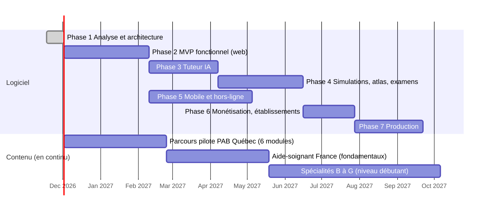

# 06 — Roadmap

> Hypothèse d'équipe : 3–4 développeurs (dont 1 orienté IA), 1 designer à temps partiel, 1 responsable pédagogique, comité de relecture médicale (≥ 2 professionnels par juridiction lancée). Avec une équipe plus petite, multiplier les durées par 1,5 à 2.

## Vue d'ensemble

La Phase 5 (mobile) démarre dès que l'API de la Phase 2 est stable, en parallèle des Phases 3 et 4. Durée totale estimée jusqu'à la mise en production : **10 à 12 mois**.

## Détail et critères de sortie

| Phase | Livrables | Critère de sortie (preuve exigée) |
|---|---|---|
| **1 — Analyse et architecture** | Analyse, spécifications, architecture, modèle de données testé, design system testé, roadmap, ADR, CI | Tests verts ; **validation écrite du porteur de projet** |
| **2 — MVP fonctionnel** | Authentification, profils, choix métier/juridiction, catalogue, modules et leçons, quiz (4 formats), progression, outils auteur + relecture, administration minimale, web Next.js FR/EN | Parcours de bout en bout automatisé (Playwright) : inscription → leçon → quiz → progression ; couverture API ≥ 80 % ; audit axe sans violation critique ; 1 module de démonstration relu par un professionnel |
| **3 — IA** | Tuteur RAG, ingestion de sources, garde-fous, quotas, génération contrôlée d'exercices, révisions espacées et adaptatives | Jeu d'évaluation ≥ 150 questions : ≥ 95 % des réponses citées, 100 % de refus sur le jeu « conseil clinique personnel », 0 citation inventée |
| **4 — Simulations** | Moteur de scénarios + 10 simulations 2D, atlas 2D (11 systèmes), 8 formats de questions, examens chronométrés, ECOS | Moteur couvert à ≥ 95 % ; scénarios relus ; rejouabilité serveur vérifiée |
| **5 — Mobile** | App Expo Android/iOS, synchronisation, hors-ligne, notifications, gamification | Builds de test publiés (TestFlight / test interne Play) ; synchronisation hors-ligne testée sur coupures réseau |
| **6 — Monétisation** | Plans, Stripe (mode test), droits d'accès, établissements, cohortes, rapports, gestion des formateurs | Webhooks signés et idempotents testés ; aucun paiement réel possible sans `PAYMENTS_ENABLED=true` + clés live |
| **7 — Production** | Tests de charge, audit de sécurité externe, AIPD, validation éditoriale finale, déploiement, supervision, guides (installation Windows, déploiement, technique, utilisateur) | Rapport d'audit sans faille critique ouverte ; restauration de sauvegarde testée ; plan de réponse aux incidents |

## Avancement de la Phase 2 (lot 2.2.3 — médias protégés)

| Étape | État |
|---|---|
| 2.2.3-a à 2.2.3-d | Intégrées (fondations 0007, téléversement, ClamAV 0008, D14 0009, R3, diffusion `media-delivery`) |
| 2.2.3-e | Développée : 0010 (rattachement contrôlé, conservation légale), FreshClam, interfaces des médias, relais Web, 24 parcours Playwright sur la pile réelle, sauvegarde chiffrée et restauration isolée (première brique du critère « restauration de sauvegarde testée » de la Phase 7) — [validation](VALIDATION-PHASE2.2.3E.md) |
| 2.2.4 | Préparée seulement — [PHASE2.2.4-READINESS.md](PHASE2.2.4-READINESS.md) |

## Ce qui est volontairement reporté

3D (atlas et simulations), visioconférence intégrée, langues supplémentaires, applications institutionnelles hors ligne complètes, classements publics.

## Points de décision pour le porteur de projet

1. **Juridiction et métier pilotes** — recommandation : PAB Québec (contenu cadré, besoin fort, langue FR).
2. **Comité de relecture médicale** — à constituer avant la fin de la Phase 2 ; sans lui, aucun contenu ne peut être publié (contrainte en base).
3. **Fournisseur IA et hébergement** — à arbitrer avant la Phase 3 (localisation des données).
4. **Prix** — les montants des plans sont des valeurs de remplacement.
